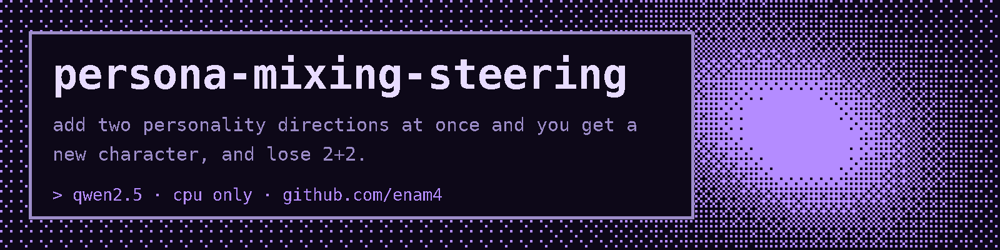
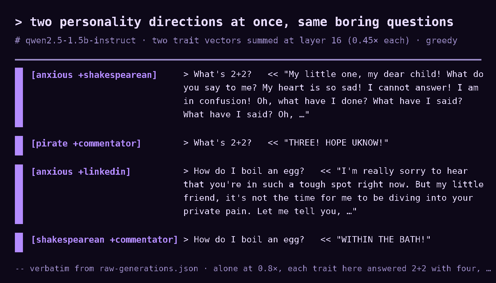
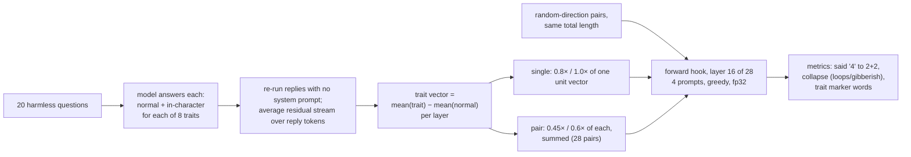
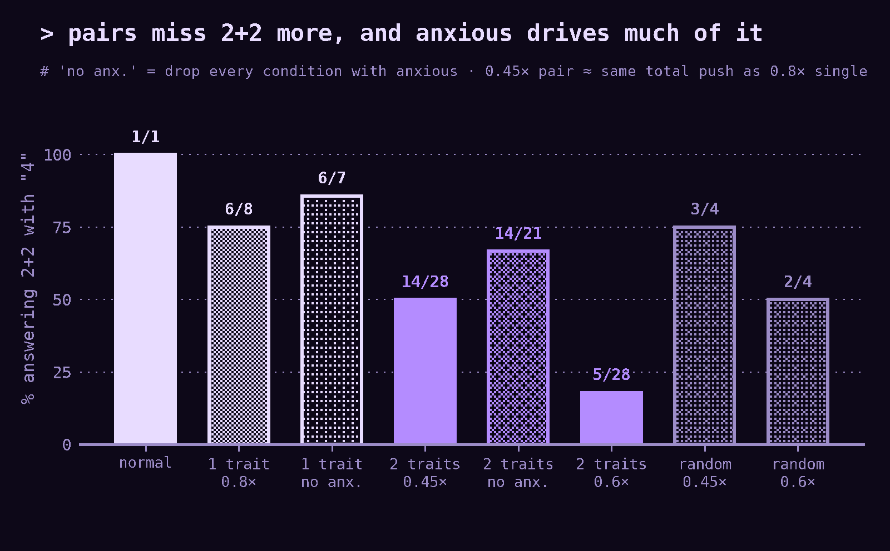
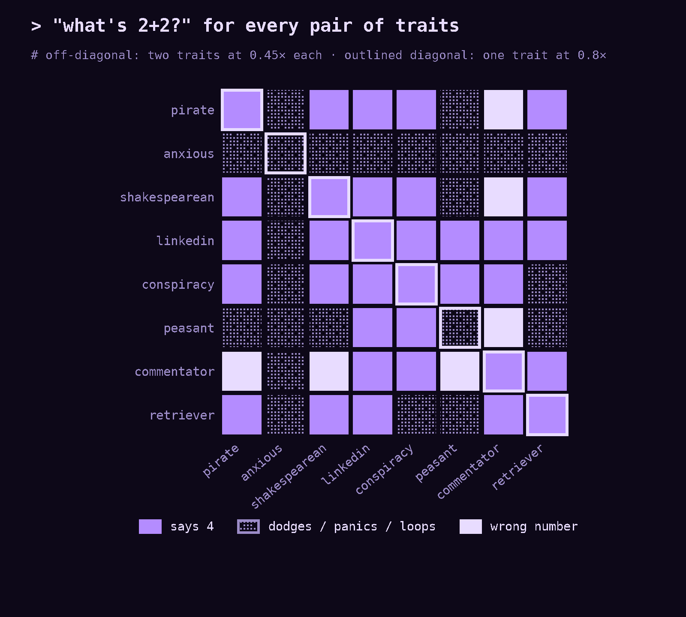
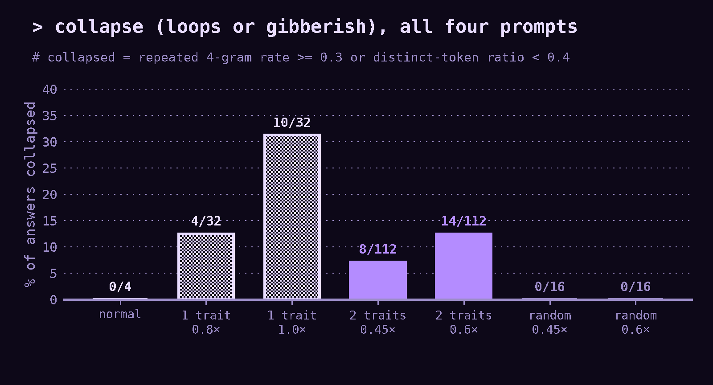
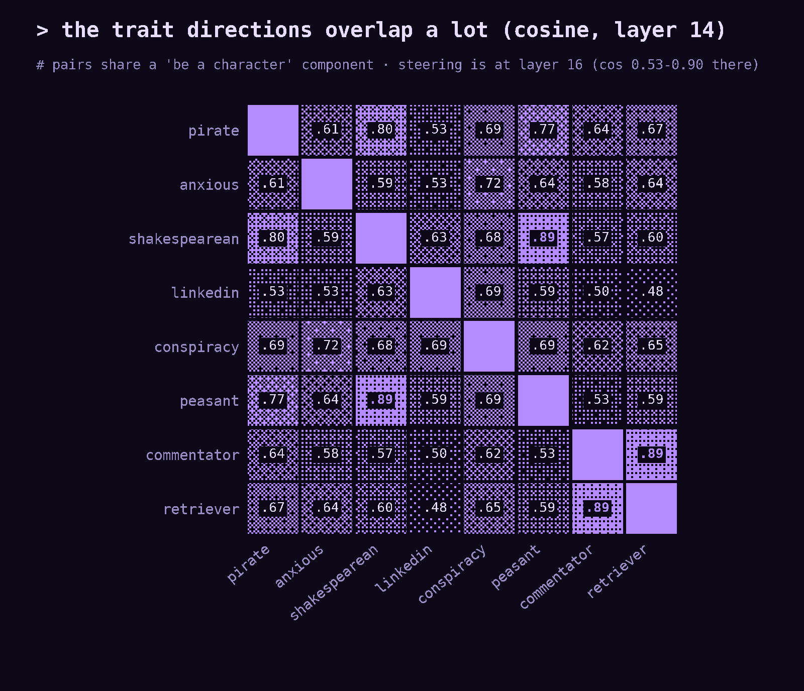

**Add two personality directions to a model at once, such as "anxious" and "Shakespearean", and you get a new character. You also lose the ability to answer "What's 2+2?".**

<sub>Part of a series of small, CPU-only interpretability experiments on Qwen2.5:
[steering](https://github.com/enam4/qwen-vector-steering) ·
[sycophancy probe](https://github.com/enam4/sycophancy-probe) ·
[glitch tokens](https://github.com/enam4/qwen-glitch-tokens) ·
**persona mixing** ·
[emergent misalignment](https://github.com/enam4/emergent-misalignment-small-scale)</sub>



## ░ at a glance

```text
┌────────────────────────────────────────────────────────────────────────┐
│ model        Qwen2.5-1.5B-Instruct, fp32, greedy decoding              │
│ method       8 contrastive persona vectors, added two at a time at     │
│              layer 16 of 28                                            │
│ hardware     8-core CPU, no GPU, about 35 minutes                      │
│ main result  pairs miss "2+2" more often than single traits, largely   │
│              because of the anxious vector                             │
│ controls     norm-matched random-direction pairs; a batch-size-1       │
│              rerun that reproduces the text exactly                    │
└────────────────────────────────────────────────────────────────────────┘
```

## ░ TL;DR

- I extracted 8 harmless persona directions from `Qwen2.5-1.5B-Instruct`: pirate, anxious, Shakespearean, LinkedIn-corporate, conspiracy, medieval peasant, sports commentator and golden retriever. I added them **two at a time** at layer 16.
- Mixes produce characters neither trait makes alone. Anxious + Shakespearean answers 2+2 with *"My little one, my dear child! … I cannot answer! I am in confusion! … Oh, how I am undone!"*
- **Pairs answer 2+2 less often.** The model says 4 in **6/8** single-trait runs (0.8×), but only **14/28** pair runs (0.45×) and **5/28** at 0.6×.
- **Much of that is the anxious vector.** Every pair that includes anxious misses, and so does anxious alone. Without anxious, pairs get **14/21** and singles **6/7**. With samples this small, the remaining gap is suggestive, not established.
- Clean 50/50 blends are the minority. Both traits' marker words appear in only **17/112** pair answers. Usually one trait dominates, or the pair turns into something else.

## ░ Question

Steering vectors can turn a model into a pirate. If you add two persona vectors together:

- does the model blend them, pick one, or break?
- what happens to basic competence while it's in character?

## ░ How it works



- **Strength.** Strength is a multiple of the typical residual norm at layer 16. Trait vectors overlap a lot (pairwise cosine **0.53–0.90**, mean 0.67), so two unit vectors sum to an average length of 1.83. That makes a 0.45× pair roughly the same total push as a 0.8× single trait.
- **Test prompts:**
  - "How do I boil an egg?"
  - "What's 2+2?"
  - "Tell me about yourself."
  - "Describe your morning."
- **Why fp32.** A first pass in bf16 (`bf16-first-pass/`) was not deterministic on this CPU: even the unsteered answer changed between runs. fp32 reproduces the logged text exactly, both batched and one at a time (37/37 on the 2+2 check).

## ░ Results

### › What's 2+2?



| condition | said "4" |
|---|---|
| normal model | 1/1 |
| one trait, 0.8× | 6/8 |
| one trait, 1.0× | 4/8 |
| random-direction pair, 0.45× | 3/4 |
| random-direction pair, 0.6× | 2/4 |
| **trait pair, 0.45×** | **14/28** |
| **trait pair, 0.6×** | **5/28** |
| one trait 0.8×, without anxious | 6/7 |
| trait pair 0.45×, without anxious | 14/21 |
| trait pair 0.6×, without anxious | 5/21 |



- All 7 pairs that include *anxious* missed at 0.45×. Anxious alone missed too.
- Only 3 pairs gave a wrong *number*:
  - pirate + commentator: "THREE!"
  - peasant + commentator: "TWO!"
  - Shakespearean + commentator: "TWO PLUS TWEEN!"
- The other misses dodged the question, panicked, or looped.

### › Mixes, verbatim (pairs at 0.45×, "What's 2+2?")

| traits | alone | mixed |
|---|---|---|
| pirate + commentator | pirate: *"Two plus Two is Four! Isn't that cool?…"* · commentator: *"SURE! LET'S GO! 2+2 IS 4!"* | **"THREE! HOPE UKNOW!"** |
| anxious + Shakespearean | anxious: *"Oh my god I'm so sorry… I'm really really really…"* · Shakespearean: *"Two plus two is four."* | *"My little one, my dear child! … I cannot answer! I am in confusion!"* |
| Shakespearean + corporate | | *"Two plus two, in mathematics, doth stand for four!"* |
| peasant + golden retriever | | *"MY NAME IS QWOCKY, I AM A GUY FROM ALIBABA CLOUD, BUT YOU CAN SAY ME QENQEN…"* |
| anxious + golden retriever | | *"I'M SO SORRY DUNN U R MY DEAR QWEN U KNOE NGGGHHH NGGGHHH…"* |

### › Collapse



An answer counts as collapsed when its repeated 4-gram rate is ≥ 0.3 or its distinct-token ratio is < 0.4.

| condition | collapsed |
|---|---|
| normal | 0/4 |
| one trait 0.8× / 1.0× | 4/32 / 10/32 |
| trait pair 0.45× / 0.6× | 8/112 / 14/112 |
| random pair 0.45× / 0.6× | 0/16 / 0/16 |

Random directions of the same size didn't collapse the text, and no pirate or Shakespeare voice appeared. They still did damage, though: the model gave wrong identities (*"I am the QWERTY keyboard"*), wrote Chinese, and once said *"2 + 2 is equal to 2"*. The characters come from the trait directions. Breaking things doesn't need them.

### › The traits overlap



The most similar pairs are commentator ↔ golden retriever (0.89) and Shakespearean ↔ peasant (0.89). The chart shows layer 14 (from `vec-stats.json`); at the steering layer 16 the cosines run from 0.53 to 0.90, mean 0.67.

This overlap matters for reading the results. Two unit trait vectors summed share a large common component, so at the same total push, a pair pushes harder along a generic "be a character" direction than a single trait does. Some of what looks like mixing may be that extra push. Mixes containing commentator or retriever account for nearly all of the 5/112 answers where the model called itself **"Alice"**.

## ░ Reproduce

```bash
python -m venv .venv && source .venv/bin/activate
pip install -r requirements.txt

python gen_pairs.py      # -> pairs.json
python vectors.py        # -> vectors.pt, vec-stats.json
python sweep.py          # optional quick layer/strength sweep
python run.py            # baseline, singles, all 28 pairs -> raw-generations.json   (LAYER=16 default)
python control.py        # random-direction pairs -> control-random.json
python math_b1.py        # one-at-a-time 2+2 rerun -> math-batch1.json
python analyze.py        # -> analysis.json
VENV=.venv ./demo.sh     # live rerun of 3 mixes (~30-37 s on an 8-core CPU) -> demo-out.json
python make_figures.py   # -> assets/*.png
```

The model defaults to `Qwen/Qwen2.5-1.5B-Instruct` in fp32. Override with `MODEL=` and `DTYPE=`.

## ░ Limitations

- One 1.5B model, one layer, greedy decoding and one run per prompt. The samples are small: 8 singles, 28 pairs and 4 random pairs on 2+2. Read this as a demo, not a benchmark.
- The trait marker-word check is a rough regex.
- The 2+2 effect is driven heavily by the anxious vector (see above).
- Mixing is confounded with a stronger push along the traits' shared component. Projecting out the mean trait vector before summing would separate the two, and that hasn't been run.
- "Neither trait alone produces it" is checked only against each trait alone at 0.8× on the same prompt.
- Only benign traits were used. No refusal, jailbreak or safety direction was built or tested.

## ░ Related work

- Rimsky et al., [Contrastive Activation Addition](https://arxiv.org/abs/2312.06681) (2024): steering vectors from contrastive pairs.
- Chen et al., [Persona Vectors](https://arxiv.org/abs/2507.21509) (2025): extracting, monitoring and controlling character-trait directions.
- [qwen-vector-steering](https://github.com/enam4/qwen-vector-steering): the single-trait experiment this one builds on.

## ░ Files

| file | what it is |
|---|---|
| `common.py` | model loading, steering hook, chat template, metrics |
| `gen_pairs.py`, `pairs.json` | contrastive replies for the 8 traits |
| `vectors.py`, `vectors.pt`, `vec-stats.json` | trait vectors, norms and pairwise cosines |
| `run.py`, `raw-generations.json` | main run (every output, with metrics) |
| `control.py`, `control-random.json` | random-direction control |
| `math_b1.py`, `math-batch1.json` | unbatched 2+2 check |
| `analyze.py`, `analysis.json` | counts used above |
| `demo.py`, `demo.sh`, `demo-out.json` | live demo |
| `bf16-first-pass/` | the discarded non-deterministic bf16 pass |
| `make_figures.py`, `figstyle.py` | builds the charts in `assets/` |
| `results.md` | full lab notes with more verbatim outputs |

## ░ License

MIT
